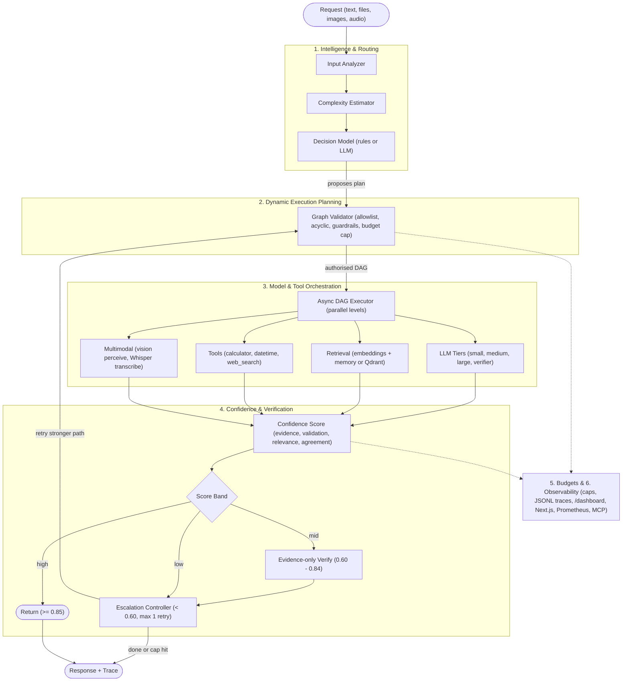

# NeuroRoute

**Adaptive AI Inference & Orchestration Platform**

Most AI applications send every request to one fixed pipeline —
usually the biggest model they have. NeuroRoute treats inference
as a *routing* problem instead: a lightweight decision model
decides **how** each request should be answered (which model
tier, whether to retrieve, which tools, whether an image or
audio file must be perceived first, how much budget it may
spend), a validator authorises the resulting execution graph,
and a confidence engine checks the outcome and escalates when
it isn't good enough. The objective is **quality per unit
cost**, measured against fixed always-large and always-medium
baselines on identical datasets — decision and verification
overhead included in NeuroRoute's own totals.

Everything runs locally (Ollama) with a deterministic mock mode
for tests and demos; no API keys are required.

## Headline results (real local models)

| Benchmark | Routing | Quality (NR vs large / medium) | Headline |
| --- | --- | --- | --- |
| Base, 24 queries | 24/24 | 0.97 vs 1.00 / 0.88 | **-62.6% latency** vs always-large |
| Base, costed (rules) | 24/24 | 0.97 vs 0.98 / 0.67 | **$0.000513 vs $0.001339 per query (-61.7%)**; quality/$ 1,891 vs 732 |
| Tools, 4 queries | 4/4 | **1.00** vs 0.50 / 0.25 | Quality/$ **25,641 vs 786**; -94.7% latency |
| Multipart research, 6 | 6/6 | 0.92 vs 0.92 / 0.92 | -59.9% latency at equal quality |
| Vision, 3 images | 3/3 | **0.67** vs 0.50 / 0.50 | Capability path: baselines answer blind |
| Audio, 3 voice notes | 3/3 | **0.67** vs 0.00 / 0.00 | Capability path: baselines cannot hear |

Quality is a transparent keyword-coverage proxy (documented in
each dataset), not a judge model. Full methodology, detailed
results, and the failures along the way live in the
[development log](docs/DEVELOPMENT_LOG.md) — nothing is
cherry-picked; runs that executed in the wrong configuration
are labelled as such.

## Architecture



**Request lifecycle.** (1) The input analyzer classifies the
request (modality, risk, document/image/audio attachments).
(2) The complexity estimator scores it. (3) The decision model
— deterministic rules by default, or a lightweight LLM behind
the same interface — selects a strategy or proposes a full
graph. (4) The validator authorises or rejects the plan; an
LLM never executes unchecked, and deterministic guardrails
(high-risk or document requests) outrank any model. (5) The
executor runs the DAG level by level, in parallel within a
level. (6) The confidence engine scores the result from
evidence, not self-report; below threshold, the escalation
controller retries on a stronger path — at most once, never
repeating a failed strategy without new evidence, and only
while the budget allows.

**Execution strategies** (the plan templates the decision
model chooses between):

| Strategy | Graph | Chosen when |
| --- | --- | --- |
| `direct_small` | generate (small) | Simple, low-risk queries |
| `rag_medium` | retrieve → generate (medium) | Retrieval or moderate reasoning needed |
| `verified_large` | [retrieve / perceive / transcribe →] generate (large) → verify | High complexity, high risk, or document-grounded |
| `decomposed_research` | parallel (retrieve → generate medium) per sub-question → synthesize (large) | Multi-part / comparison requests |
| `tool_assisted` | tool(s) → generate (small/medium) | Arithmetic, dates, live web facts |
| `vision_grounded` | perceive → generate (medium) | Image attachments |
| `audio_grounded` | transcribe → generate (medium) | Audio attachments |
| `llm_dag` | planner-proposed graph, validator-authorised | `NR_PLAN_MODEL=llm`: the LLM designs the graph itself |

Node kinds the validator allows: `retrieve`, `generate`,
`verify`, `tool`, `perceive`, `transcribe`. Tool nodes must
name a registered tool; perception/transcription nodes must
name an attachment; no node may invent a model tier.

**Confidence & verification.** Score = 0.35·evidence coverage
+ 0.25·validation + 0.20·retrieval relevance + 0.20·model
agreement. Bands: return ≥ 0.85, verify 0.60–0.84, escalate
< 0.60 (env-tunable; calibration findings in the
[calibration log](docs/DEVELOPMENT_LOG.md#confidence-calibration)).
Verification is evidence- and rule-based — never a second
LLM's opinion of the first.

**Safety model.** Plans are validated before anything runs
(allowlist, acyclicity, budget estimate); budgets are
re-checked after every attempt at run time; free-form code
execution is deliberately absent — the calculator evaluates an
AST allowlist instead. Optional API-key auth guards the HTTP
interface.

**Stack (as built).** FastAPI modular monolith · custom async
DAG executor · Ollama tiers (Qwen 2.5 1.5B / Llama 3.2 3B /
Qwen 2.5 7B, llava for vision) · hashing embeddings by default,
sentence-transformers when installed · in-memory vector store
by default, Qdrant when configured · faster-whisper for audio
· Next.js console + built-in observability dashboard ·
Prometheus metrics endpoint · Docker Compose · MCP server
interface. Substitutions vs the original design sketch are
documented in the [development log](docs/DEVELOPMENT_LOG.md)
(custom DAG for LangGraph, AST calculator for free-form Python
tools, vision-model transcription for a separate OCR engine).

**Interfaces.** [REST API](#rest-api) for applications; an
[MCP server](#mcp-server) (`mcp_server.py`) exposing the same
pipeline and tool registry to AI clients; two dashboards
(built-in at `/dashboard`, Next.js at `frontend/`).

## Quick start

> Python 3.10+ recommended (3.9 works via the
> `eval_type_backport` dependency in `requirements.txt`).

### 1. Install dependencies

```bash
cd neuroroute
python3 -m venv .venv && source .venv/bin/activate
pip install -r requirements.txt

# Optional capabilities (install only what you need):
pip install sentence-transformers          # semantic embeddings (all-MiniLM-L6-v2)
pip install qdrant-client                  # Qdrant vector store
pip install faster-whisper "av>=11,<13"    # local Whisper audio transcription
pip install "mcp>=1.2,<2"                  # MCP stdio server
```

### 2. Run the backend API & built-in dashboard

```bash
# Offline deterministic mock mode (default, no Ollama needed):
uvicorn backend.main:app --reload

# Real local models via Ollama (pull models once first):
ollama pull qwen2.5:1.5b llama3.2:3b qwen2.5:7b llava:7b
NR_MODEL_MODE=ollama uvicorn backend.main:app --reload

# Optional routing/storage modes:
NR_MODEL_MODE=ollama NR_DECISION_MODEL=llm uvicorn backend.main:app --reload   # LLM router
NR_MODEL_MODE=ollama NR_PLAN_MODEL=llm uvicorn backend.main:app --reload       # LLM DAG planner
NR_VECTOR_STORE=qdrant NR_API_KEY=dev-secret uvicorn backend.main:app --reload # Qdrant + auth
```

- API docs: http://localhost:8000/docs
- Built-in dashboard: http://localhost:8000/dashboard

### 3. Run the Next.js console, Docker stack, or MCP server

```bash
# Next.js frontend console (proxies /api/* -> http://localhost:8000):
cd frontend && npm install && npm run dev   # http://localhost:3000

# Full Docker stack (API + Next.js + Qdrant; uses host Ollama):
docker compose up --build

# MCP server over stdio (for Claude Desktop, Cursor, or agents):
.venv/bin/python mcp_server.py
NR_MODEL_MODE=ollama .venv/bin/python mcp_server.py
```

### 4. Send requests (`curl`)

```bash
# Health check & effective rate card:
curl localhost:8000/health

# Run a routed query:
curl -X POST localhost:8000/query -H 'Content-Type: application/json' \
  -d '{"query": "What is Python?", "session_id": "demo"}'

# Preview routing decision only (nothing executes):
curl -X POST localhost:8000/route/preview -H 'Content-Type: application/json' \
  -d '{"query": "Analyse this research paper", "attachments": ["paper.pdf"]}'

# Upload an image/document/audio file and query against it:
curl -X POST localhost:8000/documents -F "file=@benchmark/assets/chart.png"
curl -X POST localhost:8000/query -H 'Content-Type: application/json' \
  -d '{"query": "What does this chart show?", "attachments": ["chart.png"]}'

# Inspect traces & metrics:
curl "localhost:8000/traces?session_id=demo"
curl localhost:8000/metrics/summary
curl localhost:8000/metrics/prometheus
```

### Configuration

All environment variables are optional (defaults run in offline `mock`/`rules` mode; see `.env.example`):

| Variable | Effect |
| --- | --- |
| `NR_MODEL_MODE` | `mock` (default) or `ollama` |
| `NR_OLLAMA_URL` | Ollama base URL (default `http://localhost:11434`) |
| `NR_OLLAMA_SMALL` / `_MEDIUM` / `_LARGE` / `_VERIFIER` | Override Ollama model per tier (`qwen2.5:1.5b`, `llama3.2:3b`, `qwen2.5:7b`, `llama3.2:3b`) |
| `NR_DECISION_MODEL` | `rules` (default) or `llm` router |
| `NR_PLAN_MODEL` | `strategy` (default) or `llm` DAG planner |
| `NR_DECISION_TIER` | Tier used by LLM router/planner (default `small`) |
| `NR_EMBEDDINGS` | `auto` (default: MiniLM if installed, else `hash`), `hash`, or `sentence-transformers` |
| `NR_VECTOR_STORE` | `memory` (default) or `qdrant` |
| `NR_QDRANT_URL` / `NR_QDRANT_PATH` | Qdrant server URL, or local embedded path (default `data/qdrant`) |
| `NR_VISION_MODEL` | Vision model for `perceive` (default `llava:7b`) |
| `NR_AUDIO_MODE` / `NR_WHISPER_MODEL` | `auto`/`whisper`/`mock` (default `auto`); Whisper model size (default `tiny`) |
| `NR_RETURN_THRESHOLD` / `NR_ESCALATE_THRESHOLD` | Confidence band thresholds (defaults `0.85` / `0.60`) |
| `NR_TRACES_FILE` | JSONL trace file path (default `data/traces.jsonl`; empty disables persistence) |
| `NR_API_KEY` | When set, non-public routes require `X-API-Key` or `Authorization: Bearer` |
| `NR_PRICE_<TIER>_PER_1K` | Override modelled USD/1K rate (`SMALL`, `MEDIUM`, `LARGE`, `VERIFIER`) |
| `NEUROUTE_API_URL` | Backend URL proxied by `frontend/` (default `http://localhost:8000`) |

> Environment variables live only in the terminal that sets
> them — the [development log](docs/DEVELOPMENT_LOG.md) documents
> three separate runs that silently executed in the wrong
> configuration because of this. Pin modes inline in benchmark
> commands.

## REST API

All routes live in `backend/main.py`. When `NR_API_KEY` is set,
non-public endpoints require `X-API-Key` or `Authorization: Bearer <key>`.

| Method & Path | Purpose |
| --- | --- |
| `POST /query` | Run the adaptive pipeline (`query`, optional `attachments`, `budget`, `session_id`) |
| `POST /route/preview` | Return input analysis, complexity estimate, and validated plan without executing |
| `POST /documents` | Upload `.pdf`/`.txt`/`.md` into the vector index, or store image/audio files for per-query perception/transcription |
| `GET /documents` | List active embedder and indexed document chunk counts |
| `GET /models` | List registered model tiers, capabilities, context windows, and reference rates |
| `GET /traces` | List execution traces (filterable by `?session_id=...`) |
| `GET /traces/{request_id}` | Fetch a single execution trace |
| `GET /metrics/summary` | Aggregate request count, latency, cost, tokens, escalation rate, and per-strategy counts |
| `GET /metrics/prometheus` | Prometheus exposition metrics (`text/plain; version=0.0.4`) |
| `GET /health` *(public)* | Service status, active modes, embedder, vector store, auth flag, and effective rate card |
| `GET /dashboard` *(public)* | Built-in single-page observability dashboard |
| `GET /docs` *(public)* | Interactive OpenAPI (Swagger) documentation |

## MCP server

`mcp_server.py` exposes the same `NeuroRoutePipeline` and tool
registry over stdio (`neuroroute_query`, `neuroroute_route_preview`,
`neuroroute_calculator`, `neuroroute_datetime`,
`neuroroute_web_search`, `neuroroute_metrics`, `neuroroute_health`).
Client config for Claude Desktop or Cursor:

```json
{
  "mcpServers": {
    "neuroroute": {
      "command": "/path/to/neuroroute/.venv/bin/python",
      "args": ["/path/to/neuroroute/mcp_server.py"],
      "env": {"NR_MODEL_MODE": "ollama"}
    }
  }
}
```

## Benchmarks

Datasets in `benchmark/` (base 24, multipart 6, tools 4,
vision 3, audio 3), each run against always-large and
always-medium fixed pipelines on identical inputs:

```bash
# Fast harness check in mock mode:
python -m benchmark.run_benchmark

# Real Ollama benchmarks (pin modes inline):
NR_MODEL_MODE=ollama NR_DECISION_MODEL=rules python -m benchmark.run_benchmark --output benchmark/results.json
NR_MODEL_MODE=ollama NR_DECISION_MODEL=llm   python -m benchmark.run_benchmark --output benchmark/results-llm.json
NR_MODEL_MODE=ollama NR_DECISION_MODEL=rules python -m benchmark.run_benchmark --dataset benchmark/queries_multipart.json --output benchmark/results_multipart.json
NR_MODEL_MODE=ollama NR_DECISION_MODEL=rules python -m benchmark.run_benchmark --dataset benchmark/queries_tools.json --output benchmark/results-tools.json
NR_MODEL_MODE=ollama NR_DECISION_MODEL=rules python -m benchmark.run_benchmark --dataset benchmark/queries_vision.json --output benchmark/results-vision.json
NR_MODEL_MODE=ollama NR_DECISION_MODEL=rules python -m benchmark.run_benchmark --dataset benchmark/queries_audio.json --output benchmark/results-audio.json

# Calibration sweep & embeddings A/B comparison:
python benchmark/calibrate.py benchmark/results-calibration.json
python benchmark/retrieval_ab.py
```

Saved real-model summaries live in `benchmark/`:
`results-full24-tuned.json`, `results-cost-rules.json`,
`results_multipart.json`, `results-tools.json`, `results-vision.json`,
`results-audio.json`, `results-calibration.json`,
`retrieval_ab_results.json`, plus earlier `results-pilot9.json`,
`results-full24.json`, and `results-cost.json`. Routing accuracy judges the *initial*
strategy (an escalation is the safety net working, not a miss).
Mock-mode runs check the harness only; their numbers are
meaningless by design.

## Tests

```bash
pytest -q                         # full suite (121 tests)
pytest -q tests/test_routing.py   # single test module
```

Routing, graph validation, the full pipeline, escalation,
retrieval, tools, multimodal paths, auth, trace persistence,
the MCP protocol round-trip, and a real embedded-Qdrant
round-trip. Tests that need optional packages (`qdrant-client`,
`faster-whisper`, `mcp`) skip automatically when those aren't
installed.

## Project structure

```
backend/
  intelligence/     analysis, complexity, decision models, routing policy
  planning/         graph generator, validator, decomposer, LLM DAG planner
  execution/        DAG executor, node executor, tools, perception, transcription
  models/           tier registry + rate card, mock/Ollama adapters
  retrieval/        embeddings, document loader, vector stores, retrieval service
  validation/       verifier, confidence estimator, escalation controller
  optimization/     budget manager
  observability/    execution tracer (+ JSONL persistence & Prometheus exposition)
  static/           built-in /dashboard HTML UI
  main.py           FastAPI app (REST, dashboards, metrics, auth)
frontend/           Next.js console (proxies /api/* to FastAPI)
mcp_server.py       MCP interface over the same pipeline
benchmark/          datasets, runner, calibration + retrieval A/B tools, saved results
tests/              pytest suite (19 test modules)
docs/               detailed development & benchmark log
requirements.txt    core dependencies + commented optional extras
Dockerfile          backend container image
docker-compose.yml  api + web + qdrant stack
.env.example        environment variable template
```

## Development log & methodology

Full benchmark write-ups, ablations, and design notes are in
[docs/DEVELOPMENT_LOG.md](docs/DEVELOPMENT_LOG.md):

- [Overhead tuning](docs/DEVELOPMENT_LOG.md#overhead-tuning) — evidence-only ad-hoc verification and per-tier `num_predict` caps
- [LLM decision model & Router A/B](docs/DEVELOPMENT_LOG.md#llm-decision-model) — rules vs `qwen2.5:1.5b` router accuracy and token trade-offs
- [Dynamic execution DAGs](docs/DEVELOPMENT_LOG.md#dynamic-execution-dags) — `decomposed_research` and `NR_PLAN_MODEL=llm`
- [Retrieval upgrade & Embeddings A/B](docs/DEVELOPMENT_LOG.md#retrieval-upgrade--real-documents--embeddings) — `hashing-1024` vs `all-MiniLM-L6-v2`
- [Confidence calibration](docs/DEVELOPMENT_LOG.md#confidence-calibration) — band sweep findings and env-tunable thresholds
- [Cost model & budgets](docs/DEVELOPMENT_LOG.md#cost-model--budgets) — modelled rate card and rules vs LLM router cost comparison
- [Tool engine](docs/DEVELOPMENT_LOG.md#tool-engine) — AST `calculator`, `datetime`, `web_search` (33x quality/$ gain)
- [Multimodal engine (vision & audio)](docs/DEVELOPMENT_LOG.md#multimodal-engine--vision) — `perceive` (`llava:7b`) and `transcribe` (`faster-whisper`)
- [Qdrant vector store & Next.js frontend](docs/DEVELOPMENT_LOG.md#qdrant-vector-store--nextjs-frontend) — embedded/server Qdrant + Next.js console
- [Infrastructure, MCP server & Trace persistence](docs/DEVELOPMENT_LOG.md#infrastructure-pack) — API-key auth, Prometheus, Docker, stdio MCP, and JSONL persistence
